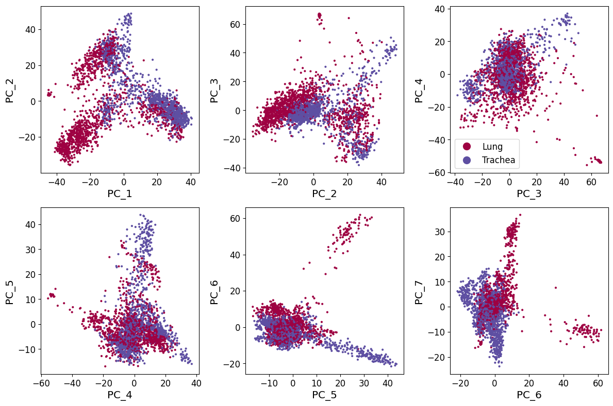
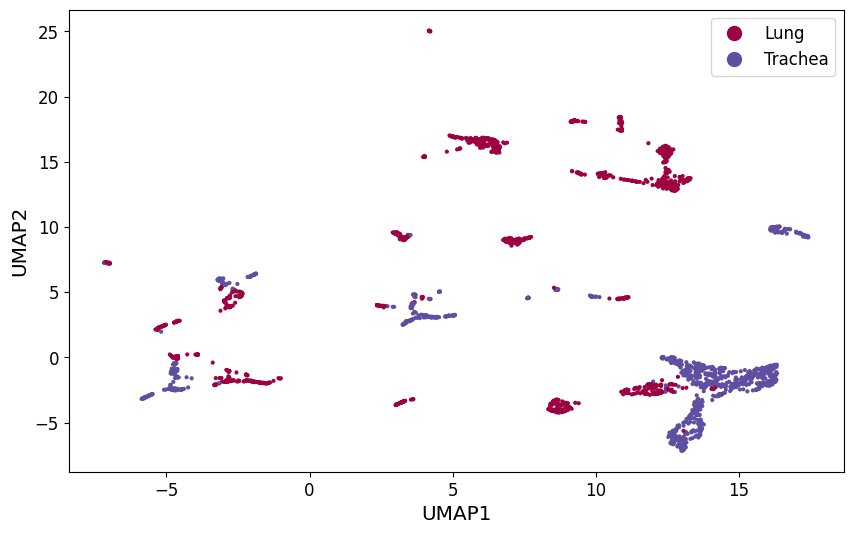
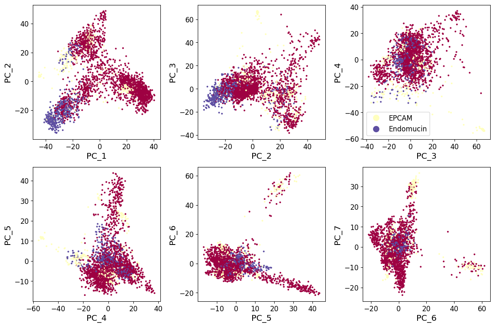
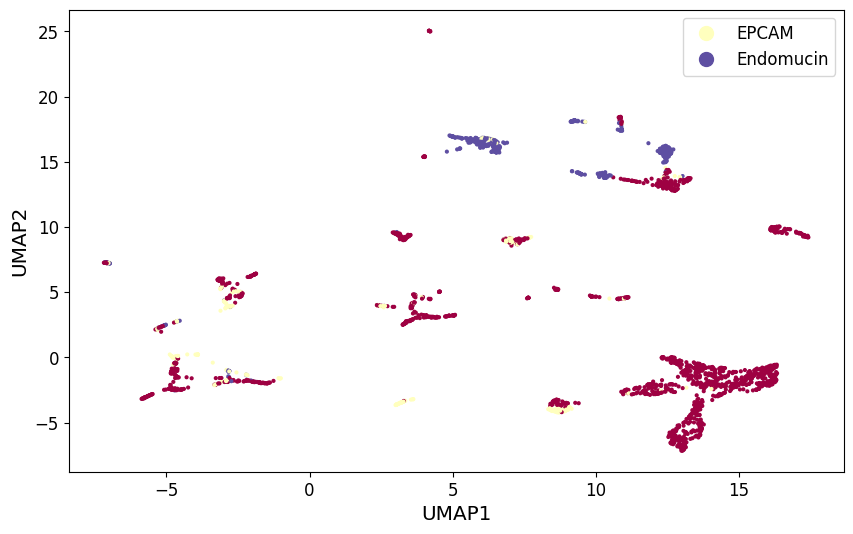
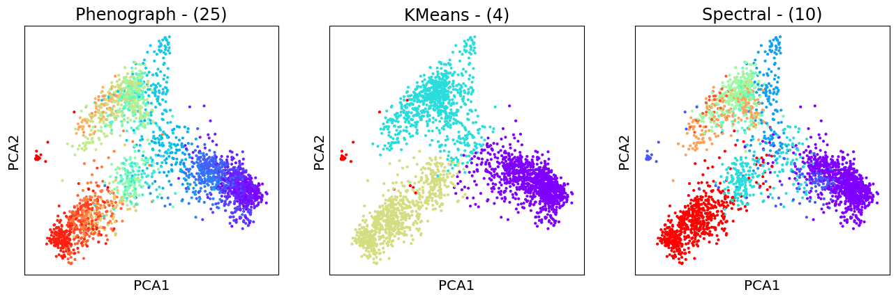
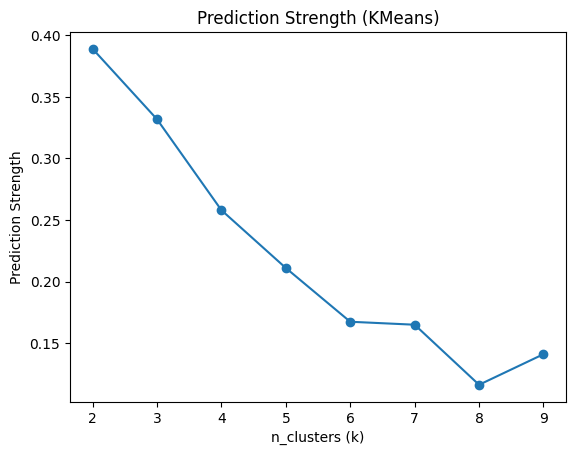
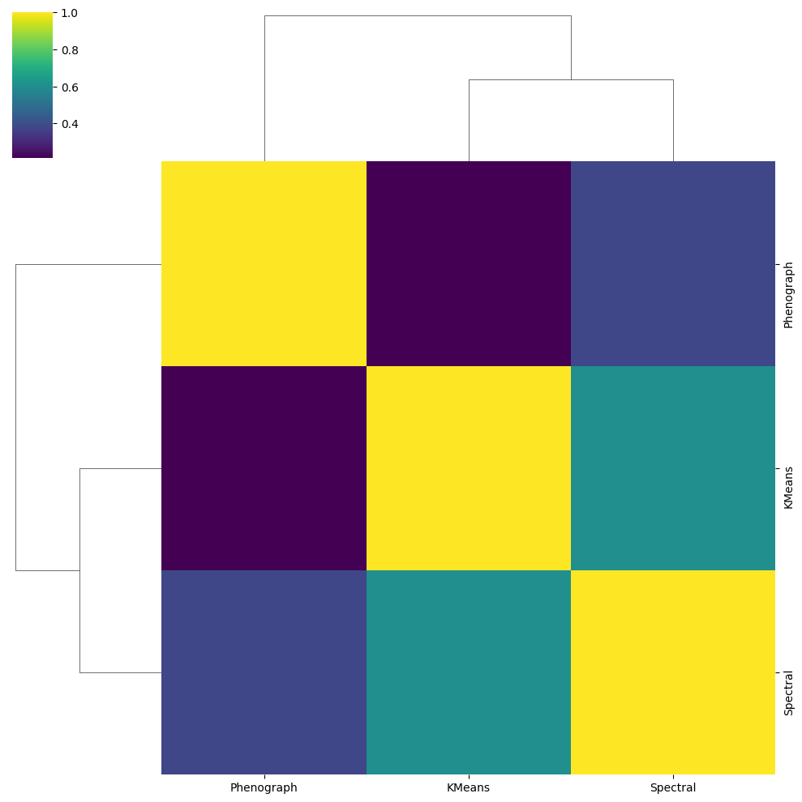
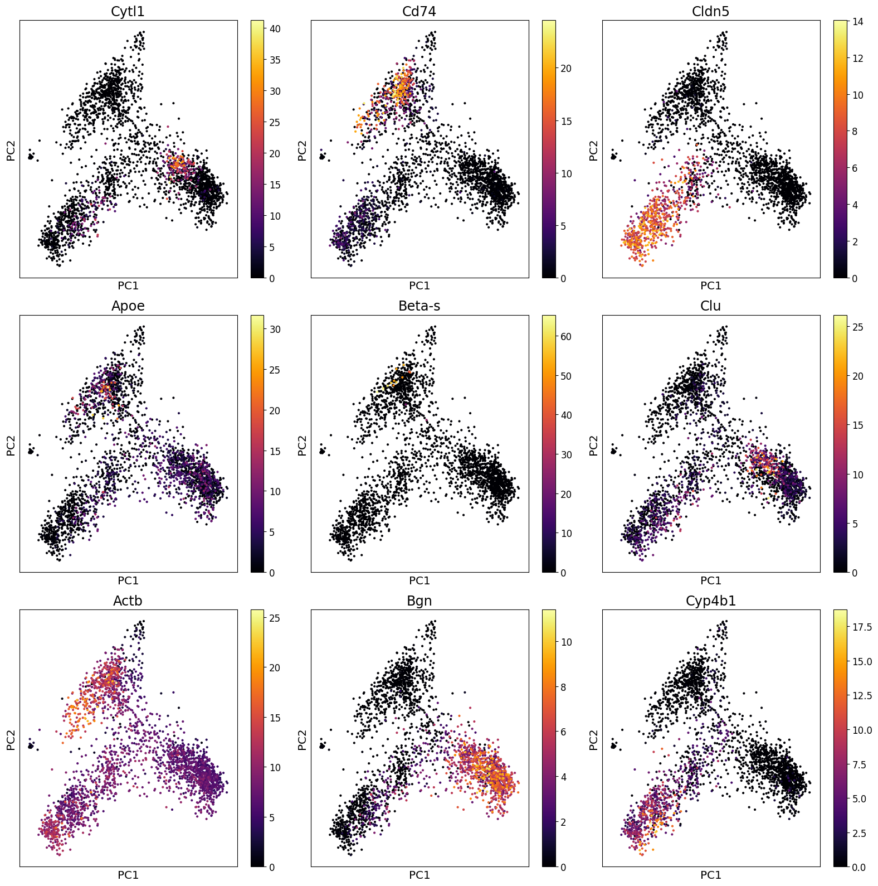

# Single-Cell RNA-seq of Mouse Lung vs. Trachea (Tabula Muris, Smart-seq2)

> An end-to-end scRNA-seq workflow — QC, normalization, PCA, UMAP, three clustering algorithms, and differential expression — applied to 3,314 FACS-sorted mouse lung and trachea cells to ask how tissue identity and cell lineage show up in low-dimensional expression space.

Final project for **Bioengineering C149** (Option 1: *Comparative scRNA-seq analysis of gene expression differences between lung and trachea populations*).

- **Notebook:** [`lung_trachea_scrna_analysis.ipynb`](lung_trachea_scrna_analysis.ipynb) (outputs included, so it can be read without re-running)
- **Report:** [`report/Lung_vs_Trachea_scRNA-seq_Report.pdf`](report/Lung_vs_Trachea_scRNA-seq_Report.pdf)

## Research question

How do differences in transcriptional programs and cellular composition between lung (gas exchange: alveolar type I/II epithelium, macrophages, microvascular endothelium) and trachea (conducting airway: basal and multiciliated epithelium) appear in low-dimensional structure, and which genes drive tissue- and lineage-specific separation?

## Pipeline

| Step | Method | Result |
|---|---|---|
| Load & merge | `scprep`; lung and trachea matrices concatenated with batch labels; metadata joined by plate barcode | 1,923 lung + 1,391 trachea = **3,314 cells × 23,433 genes** |
| Cell QC | Keep cells with library size between the 10th and 90th percentile | **2,650 cells** |
| Gene QC | Remove genes detected in fewer than 10 cells | **16,619 genes** |
| Normalize | Library-size normalization, then square-root transform (variance stabilization) | — |
| Reduce | Dense PCA (50 components); UMAP (default parameters) on the PCs | — |
| Cluster | Phenograph (30-NN, Louvain), K-means (k = 4), spectral clustering (k = 10, graphtools affinity) | 25 / 4 / 10 clusters |
| Choose k | Prediction strength (3-fold CV) for K-means, k = 2…9 | see below |
| Compare | Adjusted Rand Index between clusterings | clustermap |
| Differential expression | Per-cluster vs. rest t-test, ranked by \|t\| | marker genes |

## Results

### Tissue identity is a major axis of variation
PCA and UMAP separate lung from trachea cells into largely distinct regions, with overlap where the two organs share cell types (epithelial, endothelial, stromal, immune).

| PCA, colored by tissue | UMAP, colored by tissue |
|---|---|
|  |  |

### Lineage (subtissue) markers separate cells strongly
Coloring by the available subtissue labels (EPCAM-positive epithelial vs. Endomucin-positive endothelial) shows distinct lineage regions in PC space; the report argues lineage is at least as strong an axis of variation as organ of origin.

| PCA, colored by subtissue | UMAP, colored by subtissue |
|---|---|
|  |  |

### Clustering
Phenograph resolves 25 fine-grained clusters (max modularity Q ≈ 0.928), K-means with k = 4 gives broad groups, and spectral clustering with k = 10 falls in between; Adjusted Rand Index compares the three.



| K-means prediction strength | Agreement between algorithms (ARI) |
|---|---|
|  |  |

Prediction strength by k: 2 → 0.389, 3 → 0.332, 4 → 0.258, 5 → 0.211, 6 → 0.167, 7 → 0.165, 8 → 0.116, 9 → 0.141.

### Marker genes and differential expression
- Cd74 (MHC class II–associated; immune marker) is highest in Phenograph cluster 14 (101 cells, all with FACS selection "Multiple").
- Phenograph cluster 12 vs. all other cells, top genes by |t|: *Emp3* (51.1), *Ly6a* (46.1), *Ly6c1* (37.5), *Cd44* (36.5), *Gpx8*, *Smad7*, *Plscr1*, *Ecm1*, *Col6a3*, *Vasn*, *Serpinf1*, *Dcn*, *Mfap5* — a profile that includes several extracellular-matrix / stromal genes (e.g., *Dcn*, *Col6a3*, *Mfap5*).



## Limitations

- Tissue and lineage conclusions are drawn from PCA/UMAP visualizations and are qualitative; UMAP geometry depends on seed and neighbor parameters.
- Subtissue labels are available for only a subset of cells and rely on two markers (EPCAM, Endomucin), which oversimplifies cell identity; a full annotation (e.g., Tabula Muris cell ontology labels) would give finer resolution.
- Canonical markers named in the report (*Sftpc* for alveolar type II, *Krt5* for basal, *Foxj1* for ciliated cells) come from the literature; expression overlays for them would directly test the tissue-specific interpretation.
- Prediction strength decreases monotonically with k (highest at k = 2, no value near the conventional 0.8 stability threshold), so the k = 4 K-means result is a descriptive grouping rather than a statistically preferred partition.
- Lung–trachea separation may partly reflect sampling or technical effects (plate, mouse) in addition to biology; batch correction was not applied.

## Repository structure

```
.
├── README.md
├── LICENSE
├── .gitignore
├── requirements.txt
├── lung_trachea_scrna_analysis.ipynb   # full analysis with outputs
├── report/
│   └── Lung_vs_Trachea_scRNA-seq_Report.pdf
├── figures/                            # plots exported from the notebook
└── data/
    └── README.md                       # how to obtain the Tabula Muris files
```

## Reproduce

1. Download the three data files listed in [`data/README.md`](data/README.md) and place them in the repository root (next to the notebook).
2. Install dependencies (the notebook was run on Python 3.12 in Google Colab):

```bash
python -m venv .venv && source .venv/bin/activate
pip install -r requirements.txt
jupyter notebook lung_trachea_scrna_analysis.ipynb
```

Run all cells in order. The notebook saves intermediate pickles that later cells reload, and the prediction-strength search takes roughly 10 minutes.

## References

1. Tabula Muris Consortium. Single-cell transcriptomics of 20 mouse organs creates a Tabula Muris. *Nature* 562, 367–372 (2018).
2. McInnes L., Healy J., Melville J. UMAP: Uniform Manifold Approximation and Projection. *JOSS* 3(29), 861 (2018).
3. Levine J.H. et al. Data-driven phenotypic dissection of AML reveals progenitor-like cells that correlate with prognosis. *Cell* 162(1), 184–197 (2015). (PhenoGraph)
4. von Luxburg U. A tutorial on spectral clustering. *Statistics and Computing* 17(4), 395–416 (2007).
5. Rock J.R. et al. Basal cells as stem cells of the mouse trachea and human airway epithelium. *PNAS* 106(31), 12771–12775 (2009).
6. Barkauskas C.E. et al. Type 2 alveolar cells are stem cells in adult lung. *J Clin Invest* 123(7), 3025–3036 (2013).

The full reference list is in the report.

## License

MIT (see [LICENSE](LICENSE)). Tabula Muris data are not redistributed here.
